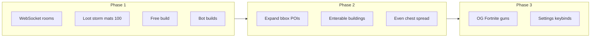

# Bentonville Royale full backlog

Chosen defaults from your answers: **full phased plan** (multiplayer + balance first), matchmaking via **whatever joins soonest** — replace PeerJS/WebRTC with a **PartyKit WebSocket room** so friends do not depend on `0.peerjs.com` or STUN/NAT. Keep the existing host-authoritative `src/net/Match.js` message protocol (`hello`, `lobby`, `start`, `in`, `snap`, `you`, `world`, `over`).

## Phase 1 — Join works + balance + modes

### Multiplayer (blocks “can’t join”)
- Replace `src/net/Room.js` PeerJS client with a PartyKit room client (room id = current `BR####` code).
- Add a tiny PartyKit worker that relays host/guest JSON; host still owns sim.
- Wire host/join in `src/main.js` unchanged at the Match API level.
- Deploy PartyKit project; point the client at that host via env (e.g. `VITE_PARTYKIT_HOST`).
- Browser-verify: two tabs host → copy code → join → lobby roster → start match. Solo PLAY still works with `role: 'solo'`.

### Match / loot / storm / mats / bots
All tunables live mainly in `src/core/config.js`, `src/game/Loot.js`, `src/game/Storm.js`, `src/game/Combat.js`, `src/game/Bots.js`, `src/game/Game.js`, `src/ui/menus.js`.

- **100 players:** set `MATCH.bots` to **99** (solo = 100 total). Cap remote humans as today; bots fill the rest. Add a light bot sim budget if FPS tanks (skip far bots more aggressively) so 100 stays playable.
- **More loot:** raise `MATCH.chests` / `floorLoot` / `ammoBoxes` (target ~2× current: ~140 / 220 / 90) and keep spawn area tied to the playable circle.
- **Storm starts “off”:** first phase uses a safe radius that covers the whole playable map (or `waiting` with no damage and no closing circle drawn until phase 1 shrink begins). Then existing shrink pipeline runs smaller and smaller (`STORM.phases`).
- **5× mats:** multiply pickaxe harvest grants in `Combat.swingPickaxe` / `PICKAXE` mat yields by **5** (keep object HP or also scale so trees/rocks don’t feel endless unless you want both).
- **Auto-pickup ammo:** in `Player.js` / loot interact path, auto-take nearby ammo (and ammo-box contents) without requiring `E`; keep `E` for weapons/chests/consumables.
- **Free build mode:** new title action (e.g. FREE BUILD) → `prepareNet({ role: 'solo' })` + match flags: **0 bots**, **no storm damage**, **infinite mats** (or free place), skip or soft-skip drop. Reuse existing build ghost/place; end via Leave.
- **Harder modes → better bot building:** extend `Bots._maybeBuild` so difficulty gates **multi-piece** edits (wall + ramp/floor cones), higher place rate, and shorter cooldowns on `hard`; keep easy near one piece.

### Ship gate for Phase 1
- Two-browser join succeeds on the live/dev host.
- Solo 100-player match boots; free build has no bots and free builds.
- Storm: full-map safe at start, then shrinks; mats clearly ~5×; ammo auto-loots.

## Phase 2 — Realistic POIs + enterable buildings + even chests

### Map expand (required for missing POIs)
Current OSM bbox is roughly `36.355–36.4 N`, `-94.23–-94.19 W`. **Bentonville High** (~36.351, -94.196) sits just south; **Bentonville West / Centerton** (~36.378, -94.297) sits well west. Expand fetch bbox in `scripts/fetch-map-data.mjs` (and terrain/imagery scripts), regenerate `public/data/bentonville-osm.json`, re-run terrain/trees as needed.

Named drop/HUD landmarks to add or promote in config + OSM landmarks:
- Bentonville West (West High / Centerton campus)
- Bentonville High School
- Bentonville Square (already `square`)
- Walmart Home Office (already `home_office`)
- Crystal Bridges (already)
- Memorial Park (already)

Update `DROP_ZONES` so loot bias and bus drops hit these six hard.

### Enterable buildings
Today OSM buildings are **solid prisms** (`World.resolveCircle` pushes you out). Change to **hollow shells**: collision on outer walls only, open door gaps, walkable floor inside, roof still standable. Mesh path in `WorldMeshes.addBuilding` must match (no filled slab blocking interiors).

### Even chest spread
Rework `Loot.spawnMatch`: less pure zone clustering, more **grid / Poisson** coverage across the expanded playable area with a minimum spacing, still a light POI bias so named places feel rich. Prefer interiors once buildings are enterable.

## Phase 3 — OG Fortnite guns + deep settings

### Weapons
Replace current fantasy names in `WEAPONS` with **Chapter 1 classic** stats/names (AR, Burst AR, Pump, Tactical Shotgun, SMG, Pistol, Bolt Sniper, etc.) — damage, fire rate, mag, reload, rarity ladders matching OG numbers as closely as the current hitscan model allows. Keep existing Quaternius meshes mapped to closest gun id; update loot rolls and HUD labels.

### Settings + keybinds
Extend `src/ui/settings.js` + settings screen in `menus.js`:
- More gameplay/audio/graphics toggles (FOV if camera supports it, mouse invert already exists, volume channels, show FPS, auto-pickup toggle, etc.).
- **Keybind remapper:** store `bindings: { moveForward: 'KeyW', ... }` in localStorage; route `Player.js`, `Game.js`, and `NetInput.js` through one `actions` map so remaps apply in solo and multiplayer.

## Out of scope for this plan
- Pushing GitHub while `github.com` resets (retry separately).
- Wiring unused terrain/trees/ground imagery unless Phase 2 map regen naturally includes it.
- Dedicated authoritative game server (host-authoritative friends mode stays).

## Suggested implementation order inside Phase 1
1. PartyKit Room swap + verify join
2. Config knobs (100 players, loot counts, 5× mats, storm open start)
3. Auto ammo + free build mode
4. Bot multi-piece building by difficulty
5. Then Phase 2 / 3 as above
