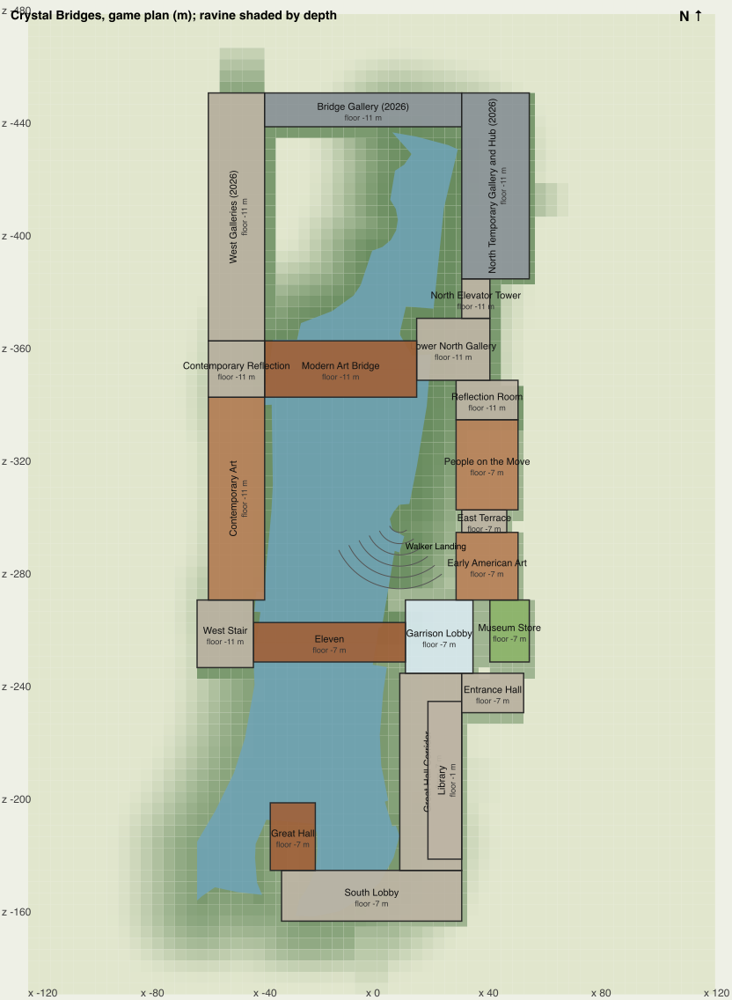

# Crystal Bridges layout (game coordinates)

This is the plan that `src/world/crystal-bridges/site.js` builds. Facts and sources are in
[`crystal-bridges-research.md`](crystal-bridges-research.md); this file records how they map onto the game.

**Coordinates.** Metres, x east, z south (north is −z), y up; the street/crest is y 0.

**Tile.** The `crystal_bridges` tile of the composed map, x −125…125, z −480…−135. It sits directly north of the Square tile, which matches the real museum's position north of downtown. It is translated, not rotated, from the real map (`scripts/compose-map.mjs`).

**Inference.** Every assignment below of a pavilion to a piece of the OSM outline is an inference (marked [INF] in the research file). The museum's floor plans are schematic and not to scale.

## Levels

Real heights from the 2015 lidar are scaled by about 0.65.

| Level | y (m) | What is there |
|---|---|---|
| Crest | 0 | Museum Way drop-off, entrance colonnade, ridges and trails, library door to the east crest |
| Main | −7 | Garrison Lobby, Eleven bridge, Early American galleries, East Terrace, Great Hall, Great Hall Corridor, South Lobby, Museum Store |
| Library | −1 | 2nd storey over the Great Hall Corridor (real: 3rd floor) |
| Lower | −11 | Modern Art bridge, Contemporary, Lower North Gallery, Reflection Room, North Tower, 2026 expansion |
| South pond | −10.4 | "Upper pond": the Great Hall stands in it |
| North pond | −13 | "Lower pond": the weir under Eleven drops 2.6 m (real 10–12 ft) |
| Expansion pond | −13.4 | Below the labyrinth weir under the Modern Art bridge |

## Pavilions

All are axis-aligned rectangles (x0…x1, z0…z1).

| Pavilion | x | z | Floor | Roof | Notes / main reference |
|---|---|---|---|---|---|
| South Lobby | −30…34 | −176…−158 | −7 | Flat, green | Exit to the Art Trail up a ramped lawn path. Venue map (41×44 ft) |
| Great Hall | −34…−18 | −200…−176 | −7 | Convex copper | Water on three sides, glass on W/N/E. Venue map 77×53 ft; OSM vase-shaped spur |
| Great Hall Corridor | 12…34 | −246…−176 | −7 | Flat copper | Curved glass west wall bowed 3.5 m; stair to the library. Audio tour stop |
| Library | 22…34 | −236…−180 | −1 | Flat copper | Shelves and tables, east door to the crest. Sensory booklet ("3rd floor") |
| Entrance Hall | 34…56 | −246…−232 | −7 | Flat | Stairs from the crest door (y 0) down to the lobby: stands in for the entry colonnade plus the elevator tower |
| Garrison Lobby | 14…38 | −272…−246 | −7 | Glass dome | Guest-services counter, door north to Walker Landing |
| Museum Store | 44…58 | −272…−250 | −7 | Green roof | Across a courtyard from the lobby. CB architecture page (living roof) |
| Eleven | −40…14 | −264…−250 | −7 | Convex copper bridge | Green-quartzite floor, glulam ribs, glass N/S, bar and kitchen end. Venue map 119×45 ft |
| West Stair | −60…−40 | −272…−248 | −11 | Flat | Landing at −7, stairs down to Contemporary |
| Early American Art | 32…54 | −296…−272 | −7 | Concave copper, high to the east | Curved west wall. Audio tour |
| East Terrace | 34…50 | −304…−296 | −7 | Flat | Glass reflection hallway |
| People on the Move | 32…54 | −336…−304 | −7 | Concave copper | Red-oak floors |
| Reflection Room | 32…54 | −350…−336 | −11 | Flat | Stairs down from Main to Lower; two-storey glass to the pond |
| Lower North Gallery | 18…44 | −372…−350 | −11 | Flat (low ceiling, "compression") | |
| North Elevator Tower | 34…44 | −386…−372 | −11 | Flat | Switchback stairs to the 100 ft footbridge (y −4.5 to the east crest). High-tier chest on the roof |
| Modern Art Bridge | −36…18 | −364…−344 | −11 | Convex copper bridge | Glass leaning out 12° (visual only), labyrinth weir below |
| Contemporary Art | −56…−36 | −344…−272 | −11 | Concave copper, high to the west | Curved east wall, pond balcony, Infinity Room enclosure (placeholder, not reproduced) |
| Contemporary Reflection | −56…−36 | −364…−344 | −11 | Flat | Link to the Modern Art bridge and the 2026 west wing |
| West Galleries (2026) | −56…−36 | −452…−364 | −11 | Steel standing seam | Arch Record / Dezeen: U-shape, steel roofs |
| Bridge Gallery (2026) | −36…34 | −452…−440 | −11 | Barrel vault (steel) | Glass bridge with the 40-seat café tables |
| North Temporary Gallery and Hub (2026) | 34…58 | −452…−386 | −11 | Sawtooth (steel) | Hub's sawtooth roof (Dezeen) |

Walker Landing is a stepwell of 11 concentric tiers (0.55 m each) from the lobby terrace (−7) down into the north pond, centred at (12, −300). The weirs (under Eleven and under the Modern Art bridge) are walkable concrete sills just above the lower pond. The north footbridge runs from (44, −4.5, −374) to (76, −0.6, −374).

## Reference images used per room

| Room | References |
|---|---|
| Whole site / ponds | OSM building relation 8240824 (outer + two inner holes), pond relation 21019486, Inside Guide floor plan, venue map |
| Eleven, Modern Art bridge | Audio tour script (cable-hung copper roofs, glulam ribs, 12° glass, labyrinth weirs). Commons: `Crystal_Bridges_Museum_of_American_Art_May_2017_19_(Eleven_Restaurant).jpg` (reference only, CC BY-SA, not copied) |
| Galleries (Early American, People on the Move) | Audio tour (curved walls, concave ceilings, red-oak floors, glulam beams through the glass). Commons `Curvaceous_corridor_in_the_Crystal_Bridges_Museum_of_American_Art.jpg` (CC BY 2.0, reference only) |
| Great Hall and Corridor | Venue map dimensions; audio tour (curved glass colonnade, polished concrete columns) |
| 2026 expansion | Architectural Record and Dezeen articles (U-shape, glass Bridge Gallery with café, steel standing-seam roofs, sawtooth Hub) |
| Gallery presentation | musewalk (MIT): see [`musewalk-notes.md`](musewalk-notes.md) and `musewalk-reference/` |

No reference photo is copied into the game. The paintings are public-domain works fetched by `scripts/fetch-cb-art.mjs`; their licenses are recorded in `public/art/sources.json`.
